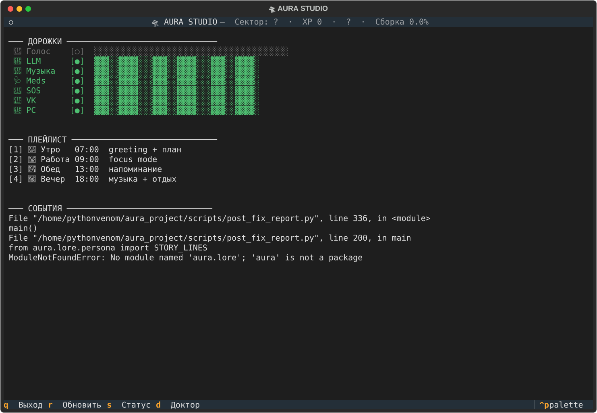
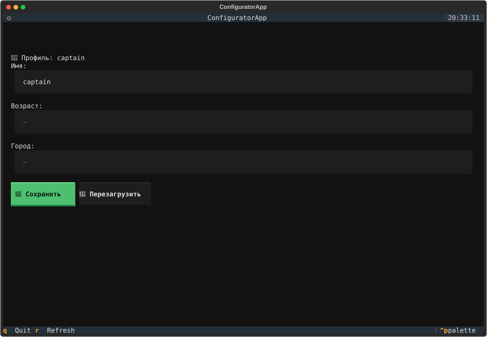

# 🛸 Aura — локальный ИИ-компаньон

**Локальный. Приватный. Открытый.**
Работает без облака. Данные не покидают устройство.
Помогает говорить с цифровым миром — банк, госуслуги, врачи, связь — голосом.

---

## 🎯 Что это

Aura — **не «Алиса» и не «Siri»**. Это **продолжение твоего разума** в цифровом мире.

Всё **локально**. Никакого облака. Никакого слежения. Никакой подписки.
Открытый код (MIT). Работает **offline**.

**Наука:**
- **Clark & Chalmers 1998** — extended mind (разум выходит за пределы черепа)
- **Licklider 1960** — man-computer symbiosis (человек + машина = симбионт)
- **Engelbart 1962** — augmenting human intellect (усиление, не замена)

---

## ✨ Что умеет

### Голос (слух + речь)
- **T-one** — streaming ASR, русский, локально
- **Piper** — синтез речи, голос Ирины
- **Fuzzy wake-word** (Levenshtein 1965) — «Аура» → «алло» работает, «ураган» — нет

### Память и разум
- **RAG** на ChromaDB (2600+ диалогов)
- **SQLCipher AES-256** — ключ в системном keyring
- **Онтология** (lore/ontology.md) — Aura знает кто она
- **Journal** — бортовой журнал
- **Mood journal** — дневник настроения

### Управление системой
- Музыка (mpv, VK), видео (YouTube)
- Окна, воркспейсы, фокус
- Громкость, яркость, питание
- Скриншоты, диктовка, метроном

### Забота (elder-care, ADR-057)
- Таблетки (напоминания + offline)
- Детектор падения
- SOS (экстренный вызов)
- Звонки, SMS, сообщения
- Воспоминания (reminiscence)
- Проактивные тревожные сигналы

### Игра (cockpit)
- 6 секторов — 6 аспектов жизни
- 3 советника — 3 внутренних голоса
- XP, ранги, квесты, гиперпрыжки
- Звёздная карта

### MCP (Model Context Protocol)
- Подключение к Claude Desktop / Cursor
- 4 инструмента: aura_chat, aura_status, aura_agents, aura_doctor
- aura serve --mcp

### Общение
- MAX, WhatsApp, Telegram, VK
- Email (IMAP/SMTP)
- SMS (модем)
- Firefox bridge (ADR-011)

### Доступность
- **WCAG 2.2 AA** (ADR-130)
- AT-SPI (screen reader)
- Blind mode (для незрячих)
- Mobile viewport для пожилых

---

## 📊 Цифры

| Параметр | Значение |
|---|---|
| **Агентов** | 91 |
| **Тестов** | 1694 (1 skipped) |
| **ADR** | 131 |
| **Директив** | Д1-Д97 |
| **Coverage** | ~47% |
| **Платформ** | 11 (Win, macOS, Linux, Android, Astra…) |
| **Профилей** | 3 (captain, batya, brat_electric) |

---

## 🚀 Установка

**Быстрый старт:** → [tutorial/01-first-step.md](tutorial/01-first-step.md)

**Кратко:**

~~~bash
git clone https://github.com/PythonVenom/aura-companion.git
cd aura-companion
python3.12 -m venv venv
source venv/bin/activate
pip install -e .

ollama pull qwen2.5:7b-instruct-q4_K_M

./run_aura.sh
~~~

**Профили:**

~~~bash
AURA_PROFILE=captain ./run_aura.sh         # полный (91 агент)
AURA_PROFILE=batya ./run_aura.sh           # elder-care (53 агента)
AURA_PROFILE=brat_electric ./run_aura.sh   # автоэлектрик
~~~

---

## 📚 Документация

**Для школьника** (6 файлов, 1194 строки):
1. 00-intro.md — что такое Aura
2. 01-first-step.md — установка за 10 минут
3. 02-voice.md — голосовые команды
4. 03-game.md — космическая игра
5. 04-agents.md — все 91 агент
6. 05-your-first-agent.md — напиши своего агента

**Для разработчика:**
- docs/adr/ — 131 архитектурное решение
- docs/GAPS.md — известные дыры (честность)
- DIRECTIVES.md — Д1-Д97 (принципы проекта)

---

## 🧪 Тесты

~~~bash
pytest -q                          # все (1694)
pytest tests/test_e2e_web.py -v    # e2e (Playwright)
pytest --cov=aura                  # с покрытием
~~~

**Пирамида:**
- Unit (много): агенты, утилиты
- Integration (средне): bootstrap, orchestrator
- E2E (мало): uvicorn + HTTP + Playwright

---

## 🔐 Безопасность

- **SQLCipher AES-256** (KDF: PBKDF2-HMAC-SHA512, 256000 итераций)
- Ключ — в **keyring** (freedesktop Secret Service), не в файле
- CSRF-защита для HTTP API (Origin whitelist)
- Rate-limit: 30 req/60s per IP (token bucket, Turner 1986)
- Constitution (ADR-129) — этические отказы

---

## 🤝 Философия

Aura — **не инструмент**. Aura — **продолжение**.

- **Локально** — данные не покидают ноутбук
- **Приватно** — ничего в облако
- **Открыто** — MIT, копируй, улучшай
- **Забота** — elder-care, accessibility
- **Честно** — GAPS.md показывает слабости

> **Девиз:** Я — не инструмент. Я — продолжение.

---

## 📜 Лицензия

MIT — делай что хочешь, только не ври.

---

## 💛 Поддержать проект

Aura — свободный проект (MIT). Всё локально, без облаков и подписок.
Если Aura помогает тебе или твоим близким:

- ☕ **CloudTips:** https://pay.cloudtips.ru/p/9ce9959c
- 🚀 **Boosty:** https://boosty.to/aura_companion
- 💬 **Telegram:** [@Pyth0nVen0m](https://t.me/Pyth0nVen0m)

**Полный список контактов и партнёрство:** [CONTACTS.md](CONTACTS.md)

## 🖥️ Ищу железо для разработки

**ПРИОРИТЕТ 1 — Мобильная станция (ноутбук):**
Для мобильной работы (батя, встречи, партнёры, тесты в полях):

- **Ноутбук:** Lenovo ThinkPad P1 Gen 7 / Dell XPS 16 / Framework 16
- **CPU:** AMD Ryzen AI 9 HX 370 / Intel Core Ultra 9 185H
- **GPU:** NVIDIA RTX 4070 Mobile (8 ГБ) / RTX 4080 Mobile
- **RAM:** 64 ГБ DDR5
- **SSD:** 2 ТБ NVMe Gen4
- **NPU:** AMD XDNA 2 / Intel NPU — для локального AI
- **Автономность:** 8+ часов (батя, выезды)

**ПРИОРИТЕТ 2 — Стационар (для тяжёлых задач):**

- **GPU:** NVIDIA RTX 4090 (24 ГБ) — 13B модели, обучение
- **CPU:** AMD Ryzen 9 7950X / Intel i9-14900K
- **RAM:** 128 ГБ DDR5
- **SSD:** 4 ТБ NVMe Gen4
- **NPU:** AMD Strix Halo / NVIDIA Jetson

**Партнёрам:** см. [PARTNERSHIP.md](PARTNERSHIP.md) · [docs/sponsorship.md](docs/sponsorship.md)

## 🌟 Ссылки

- **GitHub:** https://github.com/PythonVenom/aura-companion
- **Автор:** Воронин Иван (PythonVenom)
- **Наука:** Clark, Licklider, Engelbart, Varela, Nussbaum, Tronto, Papert

🛸

## Скриншоты

### Aura Studio — визуальный секвенсор-кабинет

### Configurator — управление профилем, уведомлениями, ключами

